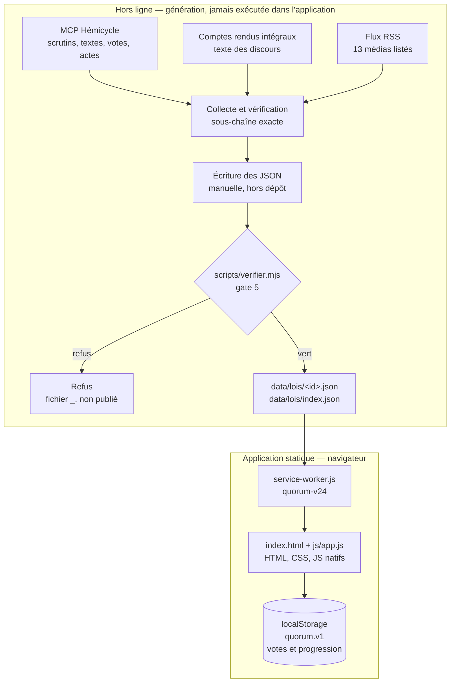
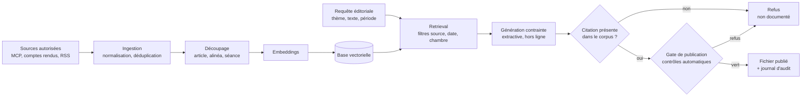

# Quorum

De l'aide pour accomplir mon devoir civique. Ce qui s'est dit. Ce qui s'est voté.

Application statique, sans framework, sans backend, sans appel réseau hors fichiers locaux.
Le vote reste dans le navigateur. Une seule loi est publiée à ce jour : le projet de loi
relatif à la protection des enfants, scrutin n° 8429 du 21 juillet 2026.

**Ce que le projet n'est pas**

- Pas un service qui donne un avis sur une loi, ni un « pour / contre » déguisé.
- Pas un chatbot : l'application ne génère aucun texte et n'appelle aucun modèle à l'exécution.
- Pas un réseau social, pas un classement public des opinions, pas de compte utilisateur.
- Pas affilié à l'Assemblée nationale ni au Sénat.
- Pas une archive : `data/lois/index.json` ne contient qu'une entrée.
- Pas un produit fini : le backend, le RAG et le freemium décrits plus bas sont des
  possibilités, pas des fonctionnalités livrées.

## Démo

```
python -m http.server 8000
```

Ouvrir `http://127.0.0.1:8000/`.

Un serveur est nécessaire : `file://` ne charge ni les JSON ni le service worker.
Aucune installation, aucun build, aucune dépendance.

Routes principales :

- `#/` accueil et loi du jour
- `#/devoir/protection-enfants` sommaire du devoir
- `#/devoir/protection-enfants/chronologie` ce qui s'est passé
- `#/devoir/protection-enfants/resume` résumé et extraits
- `#/devoir/protection-enfants/article` texte entier
- `#/devoir/protection-enfants/vote` premier vote
- `#/devoir/protection-enfants/chiffres` décompte
- `#/devoir/protection-enfants/debat` le débat mot pour mot
- `#/devoir/protection-enfants/verif` les chiffres vérifiés
- `#/devoir/protection-enfants/presse` titres de presse
- `#/devoir/protection-enfants/resultat` vote final
- `#/devoir/protection-enfants/carte` hémicycle
- `#/arbre` progression
- `#/methode` journal des contrôles
- `#/archive` archive
- `#/recherche` recherche

`http://127.0.0.1:8000/wp.html` affiche le plan du jour. `mockups.html` est une planche
de rendus photo : ce sont des maquettes, pas des preuves.

### Écrans et ordre de lecture

L'ordre est linéaire : la chronologie, le résumé et l'article entier viennent **avant** le
premier vote. Le vote est demandé après avoir lu le texte, pas avant. Ensuite viennent les
chiffres, le débat, les chiffres vérifiés, la presse, le vote final et la carte.

Les anciennes adresses `/fait` et `/texte` renvoient vers `/chronologie` et `/resume`,
`/arguments` et `/experts` vers `/debat` et `/presse`.

### Plan du jour

`wp.html` lit `data/plan.json` (sept lots, leur fenêtre horaire, leurs tâches). Les cases
cochées restent dans le navigateur, sous la clé `quorum.plan.v1`. La page se met à jour à
l'horloge et signale le lot en cours et le lot en retard. Le contenu se modifie dans
`data/plan.json`, pas dans le HTML.

## Architecture actuelle



Trois couches, et une seule source de vérité à l'exécution :

1. **Fichiers statiques** : `index.html`, `styles/`, `js/`, `service-worker.js`, `manifest.json`.
   Aucun serveur applicatif, aucun CDN, aucune police distante.
2. **JSON publiés** : `data/lois/index.json` liste les lois ; `data/lois/<id>.json` porte le
   contenu ; `data/ref/` porte les référentiels (groupes, médias, experts, verbatim, arbre).
   L'application lit ces fichiers avec `cache: "no-store"`.
3. **État local** : `localStorage` sous la clé `quorum.v1` (votes et progression), et
   `quorum.plan.v1` pour les cases du plan. Rien n'est transmis.

Le pipeline de génération vit **hors ligne**. Il interroge le MCP Hémicycle, télécharge les
comptes rendus intégraux de l'Assemblée et lit les flux RSS des médias autorisés, puis écrit
les JSON. Le contrôle `scripts/verifier.mjs` décide de la publication. L'application ne
dépend ni de Hémicycle ni d'un service d'IA à l'exécution. Dans l'état actuel, ces appels et
l'écriture du JSON sont faits à la main : aucun générateur n'est versionné.

### Statut des briques

| Brique | État dans le dépôt |
|---|---|
| Application statique, PWA, hors ligne | existe |
| Une loi publiée, contrôles bloquants gate 5 | existe |
| Générateur versionné | absent : écriture manuelle du JSON |
| Backend de génération (v1 de `PLAN.md`) | non implémenté |
| RAG, embeddings, base vectorielle | non implémenté |
| Freemium, comptes, paiement | non implémenté |

`PLAN.md` décrit une v1 (backend, génération planifiée) et une v2 (freemium). Aucune des deux
n'est dans le dépôt aujourd'hui.

### Choix d'architecture

- **Pas de backend** : la sortie est un dossier de fichiers, hébergeable sur n'importe quel
  serveur de fichiers. Le service worker met la coquille et les données en cache.
- **Pas d'appel IA à l'exécution** : tout contenu affiché vient d'un JSON pré-généré. Une
  donnée absente donne « non documenté », jamais un texte inventé au chargement.
- **Vote privé** : le vote est écrit dans `localStorage`, jamais envoyé au générateur, au
  backend ou à un tiers. Aucun compte, aucune mesure d'audience, aucun identifiant.
- **XP de processus** : l'arbre compte huit actions (lire la chronologie, ouvrir le résumé,
  lire les deux bords, ouvrir la presse, lire les chiffres, voir l'hémicycle, premier vote,
  vote final). Un vote rapporte le même point quel que soit le choix ; changer d'avis n'en
  rapporte aucun. Aucun point ne vient du contenu du vote.
- **Pas de relecture humaine** : un contrôle automatique refuse, et un refus n'est pas
  rattrapé par un comité de lecture.

### Hors ligne

Le service worker met en cache la coquille et les données. En développement il sert le réseau
d'abord, pour que toute modification soit visible. Installer la PWA depuis Chrome, puis couper
le réseau : l'application doit continuer de fonctionner.

### Cache et versions

`index.html` charge les styles et les scripts avec `?v=24`, et `service-worker.js` déclare
`quorum-v24`. Les deux numéros avancent ensemble à chaque modification de code, sinon le
navigateur peut servir une ancienne version. Les JSON sont lus avec `cache: "no-store"` :
une donnée modifiée est visible au rechargement.

## La chaîne de données actuelle

Six temps. Le détail reproductible est dans `docs/methode-donnees.md` et
`docs/pipeline-freemium.md` ; cette section n'en donne que le contrat.

```
repérer → collecter → vérifier → générer → contrôler → publier
   ↑          ↑           ↑          ↑          ↑          ↑
  score     MCP + CR    sous-chaîne   JSON     gate 5    index.json
```

| Temps | Entrée | Sortie | Qui décide |
|---|---|---|---|
| Repérer | scrutins, actes, presse | liste classée de candidats | score objectivable + choix éditorial assumé |
| Collecter | MCP Hémicycle, comptes rendus, flux RSS | faits, décomptes, citations | la source, jamais le rédacteur |
| Vérifier | citations brutes | citations acceptées | comparaison de sous-chaîne |
| Générer | faits vérifiés | `data/lois/<id>.json` | rédaction dans un schéma fermé |
| Contrôler | le fichier | code 0 ou 1 | `scripts/verifier.mjs` |
| Publier | fichier accepté | entrée dans `data/lois/index.json` | le gate, pas l'auteur |

Trois entrées seulement : le MCP Hémicycle (données parlementaires), les comptes rendus
intégraux de l'Assemblée (texte des discours), et les flux RSS de `data/ref/medias.json`
(titres de presse). Toute autre source citée doit appartenir à la liste `DOMAINES` de
`scripts/verifier.mjs`.

### Ce que la chaîne a produit sur la seule loi publiée

| Élément | Valeur constatée |
|---|---|
| lois dans `index.json` | 1 |
| dossier | `DLR5L17N54372` |
| scrutins | 2 (`VTANR5L17V8428`, `VTANR5L17V8429`), le même jour |
| chronologie | 13 étapes |
| texte adopté / texte de commission | n° 338 / n° 3018 |
| article travaillé | article 11, 9 alinéas |
| extraits | 9, dont 1 étiqueté `supprime` |
| phrases calculées (`nb_phrases`) | 3 |
| séances dépouillées | 4 comptes rendus |
| citations au verbatim | 9 |
| débat cité | 3 passages par bord |
| presse | 2 + 2 titres |
| chiffres vérifiés | 3 |
| groupes | 12, pour 577 sièges |
| sièges présents / vides | 353 / 224 |

Le scrutin n° 8429 : 258 pour, 84 contre, 10 abstentions, 1 non-votant ; 352 votants,
342 exprimés. Le scrutin n° 8428 cité dans `variante` : 178 pour, 163 contre, 5 abstentions ;
346 votants, 341 exprimés.

### Les scripts et le gate

```
node scripts/verifier.mjs                    # tous les fichiers de data/lois
node scripts/verifier.mjs data/lois/x.json   # un seul
node scripts/verifier.mjs --reseau           # vérifie aussi que chaque URL répond
node scripts/preuve-gate.mjs                 # prouve que le passage accepte et refuse
```

`verifier.mjs` refuse, il ne corrige pas. Code de sortie 1 dès qu'un fichier est refusé.
Il vérifie le schéma, les dates, les décomptes, le verbatim, la symétrie de la presse et du
débat, les ressources citées, les chiffres vérifiés, les sources et l'absence de contenu de
démonstration. Un fichier dont le nom commence par `_` est ignoré : c'est un jeu de travail,
pas une publication.

Le passage est le **gate 5** : `meta.gate` doit valoir `"5"`. Neuf codes `WP1.1` à `WP1.9`
produisent dix lignes de journal, `WP1.2` couvrant à la fois les chiffres et les sièges.
Un fichier produit par une règle plus ancienne est refusé.

`preuve-gate.mjs` fabrique un fichier complet dans le dossier temporaire, le fait accepter,
puis introduit une faute à la fois et exige le refus : un siège de trop, un siège vide non
déclaré, un siège de groupe inventé, un média hors liste, une variante absente de sa source,
une variante encore dans le texte adopté, une étiquette `supprime` sur un passage ordinaire,
une citation retouchée, un `confirmé` sans source, un `non documenté` avec source, une
affirmation retouchée. Résultat attendu : **12 cas sur 12**.

Ce script ne prouve pas que la base est vraie ; il prouve que le passage **refuse**. C'est la
seule preuve que le projet s'autorise.

### Les listes fermées

Trois listes ferment la publication : `data/ref/medias.json` (13 médias), `data/ref/experts.json`
(14 fiches) et `data/ref/verbatim.json` (4 séances, 9 passages) doivent contenir le média, la
personne ou l'organisation citée, avec son domaine, son affiliation, son rôle ou son passage.
Une entrée absente est refusée, avec ou sans drapeau. Les domaines autorisés en dur sont
`assemblee-nationale.fr`, `senat.fr`, `legifrance.gouv.fr`, `vie-publique.fr`, `data.gouv.fr`,
`hemicycle.ai`, `ciivise.fr`, `justice.gouv.fr`, plus les domaines de `medias.json`.

`source.texte_url` est obligatoire : c'est le lien vers le texte officiel, affiché en bas de
l'écran « article entier » pour un fichier publié.

### Les sièges

Les sièges non occupés ne sont attribués à aucun groupe. Chaque ligne `votes_par_groupe` porte
son nombre de `sieges` présents (pour + contre + abstention + non-votants volontaires), et le
fichier déclare à part `sieges_vides`. Le contrôle exige
`somme(sieges) + sieges_vides = 577` : les absents restent des absents. Ils sont répartis sur
l'arc et peints d'une teinte neutre, jamais empilés d'un côté.

### Le bloc facultatif `variante`

Quand un vote adopté a supprimé une phrase du texte, le fichier peut porter un bloc
`variante` : la citation exacte (`avant`), le texte d'où elle vient (`texte_source`), et le
scrutin qui l'a retirée (`supprimee_par`). Le contrôle `WP1.7` exige que la phrase soit
**mot pour mot** dans `texte_source` et **absente** du texte adopté : si elle y est encore,
le fichier est refusé. Le même décompte est vérifié (`votants = pour + contre + abstentions`,
`exprimés = pour + contre`) et doit venir d'un autre scrutin que celui de la loi. Le bloc
n'apparaît dans l'écran « article entier » que s'il est présent et validé.

### Le débat cité (`WP1.8`)

Le bloc `debat` ne contient pas de reformulation : chaque entrée est une citation recopiée
d'un compte rendu. Le contrôle exige que la citation soit **mot pour mot** dans
`data/ref/verbatim.json`, avec la **même séance** et le **même auteur**, que la date et l'URL
correspondent à celles de la séance, et que le nom figure dans `data/ref/experts.json`. Une
citation retouchée d'un seul mot est refusée.

La symétrie se juge sur le **total de caractères par bord** (rapport maximal 2,5), pas sur
chaque extrait : des citations authentiques n'ont pas la même longueur, et tronquer la plus
longue pour équilibrer reviendrait à falsifier.

### Les chiffres vérifiés (`WP1.9`)

Le bloc `verifications` ne retient que des chiffres **prononcés dans l'hémicycle**. Chaque
entrée porte sa citation (contrôlée comme ci-dessus), un verdict parmi `confirmé`, `nuancé`,
`non documenté`, une explication d'au moins 80 caractères, et ses sources. Le chiffre doit
apparaître littéralement dans la citation qu'il commente.

L'affirmation, affichée entre guillemets au-dessus du chiffre, est contrôlée elle aussi :
après normalisation, en minuscules et sans le point final, elle doit être un **fragment
exact** de la citation. Une retouche, même d'un mot, est refusée.

Un verdict `confirmé` ou `nuancé` sans source est refusé ; un verdict `non documenté` **avec**
une source est refusé aussi, puisque c'est une contradiction : « non documenté » veut dire
qu'aucune source n'a été trouvée. Le verdict ne dit jamais si la loi est bonne : il dit
seulement ce que la source établit. Il est rendu en typographie, jamais en vert ni en rouge,
pour que « vrai » ne puisse pas se lire comme « pour ».

### Ce que le gate ne vérifie pas

- Le classement éditorial d'un titre de presse dans sa colonne : le gate contrôle le média,
  le domaine et le nombre, pas le choix de la colonne.
- Le sens d'une reformulation : `resume` et `ce_qui_est_vote` sont relus par le gate pour
  leur forme et leurs sources, pas pour leur neutralité.
- La qualité de la sélection : les contrôles prouvent que rien n'est inventé et que la
  sélection est visible, pas qu'elle est représentative.

Aucun script de génération n'est versionné. La collecte se fait par appels MCP dans une
session d'assistant ; l'écriture du JSON est manuelle, ou faite par un script jetable hors du
dépôt. Ce choix est volontaire : un générateur automatique produirait des fichiers que
personne n'a lus, et le gate ne juge pas le sens.

## Le RAG backend, plus tard

> **Statut : non implémenté.** Aucun embedding, aucune base vectorielle, aucun service de
> génération, aucun backend n'existe dans ce dépôt au 14 novembre 2026. Cette section décrit
> une architecture cible et des garde-fous, pas une fonctionnalité.

### Architecture cible



Les étapes, dans l'ordre :

1. **Ingestion** : MCP Hémicycle, comptes rendus intégraux, flux RSS autorisés. Normalisation
   des espaces, apostrophes et tirets, comme `normaliser()` dans le gate.
2. **Découpage** : unités citables (article, alinéa, prise de parole, titre de presse), avec
   identifiant de source, séance, date et URL.
3. **Embeddings** : vecteurs calculés une fois par lot, jamais dans le navigateur. Modèle,
   dimension et coût : **non documentés** à ce jour.
4. **Base vectorielle** : index lecture seule, avec métadonnées de source et version de corpus.
   Produit, hébergement et sauvegarde : **non documentés**.
5. **Retrieval** : sélection de passages par similarité et filtres durs (source autorisée,
   date, chambre, thème). Un score de similarité n'est pas une preuve.
6. **Génération contrainte** : le modèle ne rédige pas un texte libre. Il choisit et assemble
   des passages du corpus, avec leur identifiant et leur lien. Toute phrase sans citation est
   rejetée.
7. **Citations obligatoires** : chaque affirmation publiée porte sa source (URL, date,
   séance ou alinéa). Pas de citation, pas de publication.
8. **Gate de publication** : les contrôles automatiques existants restent l'ultime arbitre.
   Le RAG ajoute des contrôles de couverture et de citation, il n'en retire aucun.
9. **Journal d'audit** : corpus utilisé, identifiants des passages, scores de retrieval,
   modèle et version de prompt, version du gate, coût de l'appel. Aujourd'hui `meta` porte
   `genere_le`, `gate`, `modele` et `controles` ; `prompts_version` et `couts` sont décrits
   dans `PLAN.md` mais absents du fichier publié.

### Ce que le RAG apporterait

- **Recherche dans l'archive** : retrouver une loi, un article ou une citation par le sens,
  pas seulement par mot-clé. Aujourd'hui l'écran `#/recherche` est désactivé sous 10 lois, et
  l'archive n'en contient qu'une.
- **Séries thématiques** : relier plusieurs lois d'un même thème, avec les sources de chaque
  étape.
- **Assistant éditorial hors ligne** : aider à trouver les passages candidats, les séances et
  les titres de presse avant l'écriture manuelle. Il travaille dans le pipeline, pas dans
  l'application publiée.

### Ce qu'il ne doit jamais faire

- **Répondre à la place du citoyen** : pas de « votez pour », pas de recommandation, pas de
  personnalisation selon le vote enregistré.
- **Produire un verdict sur la loi** : le RAG peut dire ce que la source établit, jamais si
  le texte est bon ou mauvais.
- **Remplacer une source** : un passage généré sans citation officielle n'est pas publiable.
  Le corpus officiel reste la référence, pas l'index vectoriel.
- **Transformer une similarité en fait** : un passage proche n'est pas un passage qui répond.

### Les garde-fous

1. **Citation obligatoire** : identifiant de source, URL, date, séance ou alinéa.
2. **Refus si la source manque** : la sortie est « non documenté », jamais une phrase
   plausible sans appui.
3. **Séparation stricte** : la génération tourne hors ligne, en lot ; l'application publiée
   ne lit que des fichiers validés. Aucun modèle, aucune clé, aucune base vectorielle dans le
   navigateur.
4. **Pas de génération à la demande** : le RAG produit un corpus, le gate le publie. Une
   requête utilisateur ne déclenche pas un appel de modèle dans la version statique.
5. **Pas de données personnelles** : le vote reste dans `localStorage` et n'entre ni dans
   l'index, ni dans les prompts, ni dans les journaux.
6. **Traçabilité** : version du corpus, du prompt, du gate et coût de chaque lot.

Ce que le RAG ne règle pas : le biais de sélection reste celui du choix des passages ; un
embedding ne prouve pas qu'une phrase est vraie ; le gate ne juge toujours pas le sens. Le
RAG déplace le problème vers la qualité du corpus et des citations, il ne le supprime pas.

## Collecte à l'échelle (scrap)

Le dépôt ne contient pas de scraper. La collecte est un enchaînement d'appels MCP, de
téléchargements de comptes rendus et de lectures de flux RSS, avec une écriture manuelle du
JSON. La question « 100 ou 1 000 lois » est donc un exercice de dimensionnement, pas un
résultat mesuré.

### Ce qui est déjà fait, sur une loi

- Un dossier, deux scrutins, 13 étapes de chronologie, 9 alinéas, 9 extraits.
- 4 séances dépouillées, 9 citations au verbatim, 3 + 3 passages de débat.
- 2 + 2 titres de presse, 3 chiffres vérifiés, 12 groupes, 577 sièges.
- Un gate vert et 12 cas de refus prouvés.
- Un coût documenté de 8 crédits pour le trajet minimal, 13 à 15 pour le trajet complet,
  23 à 25 avec les agrégats. À `valeur_eur: 0.01` le crédit, cela fait 0,08 à 0,15 € par loi
  pour les deux premiers trajets, 0,23 à 0,25 € avec agrégats.

### Ce qu'il faudrait pour 100 ou 1 000 lois

| Sujet | Ce qui manque aujourd'hui |
|---|---|
| File d'attente | Un traitement par dossier ou scrutin, avec états, reprise et abandon. `PLAN.md` prévoit deux tentatives avec l'erreur en entrée, puis l'abandon : non implémenté. |
| Idempotence | Une clé stable (dossier, scrutin) et une empreinte de source. Aujourd'hui rien n'empêche de réécrire ou de dupliquer une entrée. |
| Versionnement | Le gate est versionné (`"5"`), le cache aussi (`quorum-v24`), mais il n'y a ni version de corpus ni `prompts_version` dans le fichier publié. |
| Coût | 100 lois à 8–15 crédits = 800–1 500 crédits, soit 8–15 € à la valeur mesurée ; 1 000 lois = 8 000–15 000 crédits, soit 80–150 €. Hors hébergement, stockage, modèles et paiement. La recharge commence à 100 € HT ; l'équivalent en crédits et un éventuel prix de volume sont **non documentés**. |
| Qualité | Le gate refuse l'invention, pas le mauvais choix. À 1 000 lois, le classement de presse, la sélection des citations et la rédaction du résumé restent les points faibles. |
| Déduplication | Un même texte peut produire plusieurs scrutins, une même citation plusieurs fiches, un même titre plusieurs colonnes. Aucun mécanisme de doublon n'est versionné. |
| Sénat | Le MCP sert des données sénatoriales, mais l'application n'a pas de `data/ref/senat.json` : le gate refuse `chambre: "Sénat"` comme vote principal. Une étape sénatoriale reste possible dans `chronologie`. |
| Presse | 13 médias en liste fermée, 2 titres par colonne. La profondeur d'archive des flux RSS sur 1 000 lois n'est pas mesurée. |
| Rattachement | Le jeu `scrutins` n'a pas de colonne de rattachement au dossier : recherche plein texte puis contrôle manuel de chaque `objet_libelle`. |
| Pagination | `interroger` rend 200 lignes au plus ; un texte de plus de 200 amendements exige plusieurs pages (`decalage`). |
| Limites de débit | **Non documentées** pour un usage soutenu. |
| Stockage | La taille d'un corpus de 1 000 fiches et le mode d'indexation ne sont pas mesurés. |

À 1 000 lois, le problème principal n'est plus la collecte mais la **vérification** : chaque
fiche doit rester une sous-chaîne exacte d'une source, et le gate doit pouvoir refuser sans
relecture humaine. Un corpus plus gros augmente le nombre de refus à traiter, pas la
confiance dans le contenu.

## Modèle freemium

> **Statut : non implémenté.** Il n'y a aujourd'hui ni compte, ni paiement, ni backend, ni
> archive payante. Tout ce qui est publié est gratuit et lisible hors ligne. Cette section
> décrit une piste, avec ses coûts et ses points juridiques à valider.

| Gratuit (état actuel) | Payant (envisageable, non implémenté) |
|---|---|
| la loi du jour, en entier | archive thématique au-delà de la loi du jour |
| la chronologie, le résumé, l'article entier | séries historiques (« les lois de… ») |
| le premier vote, les chiffres | recherche plein texte dans l'archive |
| le débat mot pour mot | export, dossiers de travail |
| les chiffres vérifiés, la presse | API ou licence B2B du même corpus |
| `#/methode`, `#/arbre` | — |

Trois interdits structurent l'offre :

1. **On ne vend pas le résultat d'un vote.** Le vote de l'utilisateur n'est ni collecté ni
   monnayable ; les XP ne récompensent que le parcours, jamais le contenu du vote.
2. **La chronologie ne dépend pas du paiement.** La chronologie, le vote et le débat de la loi du jour
   restent gratuits : payer ne change pas ce qui est vrai.
3. **On ne vend pas de données personnelles.** Il n'y en a pas aujourd'hui.

Garde-fous de neutralité, quel que soit le modèle : aucun ciblage publicitaire par opinion,
vote ou thème ; aucun sponsor dans le corps d'un devoir ; aucun paywall sur la chronologie,
les chiffres et le débat ; le vote reste privé.

### Ce qui reste à vérifier avant toute offre payante

- **Licence des données de l'Assemblée nationale** : `source.licence` vaut « Licence Ouverte
  (Etalab) ». L'attribution et les conditions de réutilisation sont à respecter.
- **Redistribution commerciale des données Hémicycle** : **non documentée à ce jour**.
  C'est bloquant pour vendre une archive construite sur ces données.
- **Licence des données Sénat** : conditions de réutilisation non confirmées dans
  `lister_jeux`. Le Sénat n'est de toute façon pas modélisé comme vote principal.
- **Presse** : seuls des titres, dates et liens sont repris. Le droit de citation et les
  conditions de chaque média restent à vérifier.
- **RGPD** : aujourd'hui aucun compte, aucun identifiant, aucune mesure d'audience. Un
  backend payant créerait des comptes et des paiements : base légale, durée de conservation,
  sous-traitants et hébergement seraient à définir.
- **Hébergement** : non choisi. Un service statique ne peut pas protéger une archive : un
  fichier servi est téléchargeable. Un accès payant exige un hébergeur qui authentifie avant
  de servir le fichier.
- **Coûts** : 0,08 à 0,15 € par loi pour la collecte, mesuré ; hébergement, stockage,
  paiement, support et modèles ne sont pas mesurés. Aucun revenu n'est promis.

## Limites et ce qui reste non documenté

| Sujet | État |
|---|---|
| Archive | une seule loi publiée ; `index.json` a une entrée |
| Recherche | désactivée sous 10 lois, par choix explicite dans `js/app.js` |
| Rapport IGJ (inter-inspections) de juillet 2022, chiffre des 70 % | introuvable sur un site officiel : **non documenté**, donc non repris comme un fait |
| Vote du Sénat comme vote principal | impossible : `data/ref/senat.json` absent, le gate refuse `chambre: "Sénat"` |
| Texte des discours dans le MCP | **non servi** ; seule voie : les comptes rendus intégraux |
| Presse | titres seuls ; le bord est une classification Wikipédia contestée, affichée comme telle ; la colonne n'est pas contrôlée par le gate |
| Relecture humaine | aucune, pas même par échantillonnage ; le gate ne juge pas le sens |
| Générateur | aucun script versionné ; écriture manuelle du JSON |
| Champ `affirmation` | contrôlé : fragment exact de la citation (WP1.9) ; point final et majuscule initiale viennent de l'affichage |
| Prix d'un crédit à la recharge | **non documenté** ; seul `valeur_eur: 0.01` du solde est mesuré |
| Redistribution commerciale Hémicycle | **non documentée** |
| Licence des jeux Sénat | non confirmée |
| Limites de débit Hémicycle | **non documentées** |
| Hébergement cible | **non documenté** |
| RAG, backend, freemium | non implémentés |
| Maquettes | `assets/mockups/` sont des rendus, pas des preuves |

### Ce qui est vrai, ce qui ne l'est pas

- **Vrai** : la composition de l'Assemblée dans `data/ref/groupes.json`, avec sa source et sa
  date ; le scrutin n° 8429, le scrutin n° 8428 cité dans `variante`, la chronologie et les
  passages reproduits de `data/lois/protection-enfants.json`, tirés du MCP Hémicycle ; les
  titres de presse et les citations, avec leur lien.
- **Reformulé, source à l'appui** : les rares textes de synthèse (résumé, chronologie, points
  de l'article). Les prises de position ne sont plus reformulées : l'écran « Le débat, mot
  pour mot » donne les phrases des députés telles quelles, recopiées des comptes rendus et
  contrôlées une à une. Aucune position n'est qualifiée de meilleure.
- **Vérifié, avec sa limite** : les trois chiffres de l'écran « Les chiffres, vérifiés ». Le
  3 % et le 1 % sont confirmés par la CIIVISE (rapport public de novembre 2023, bilan du
  15 juin 2026) : ce sont des ordres de grandeur calculés à partir des plaintes, pas des
  comptages exhaustifs. Le 70 % reste « non documenté » : le rapport inter-inspections de
  juillet 2022 qui le porte n'a pas été retrouvé sur un site officiel, donc il n'est pas
  repris comme un fait.
- **Faux, assumé** : le contenu de `data/lois/_demo.json`. Il n'est pas publié ; l'index ne
  le cite pas. `data/lois/_archive-protection-souverainete-agricoles.json` est une loi
  retirée, gardée pour mémoire.
- **Maquette, assumé** : l'arbre de `data/ref/arbre.json`. Les 4 jalons, 8 thèmes et
  24 branches sont une nomenclature de démonstration ; seuls les points gagnés sont réels,
  ils ne comptent que des actions du parcours, jamais le contenu d'un vote.
- **Règle** : aucun contenu de démonstration ne doit être présenté comme vérifié dans une
  slide. Les images de `assets/mockups/` sont des maquettes.

## Structure du dépôt

```
.
├── index.html              coquille de l'application
├── wp.html                 plan du jour, page de pilotage
├── mockups.html            planche des rendus photo
├── manifest.json           PWA
├── service-worker.js       hors ligne, réseau d'abord
├── styles/                 tokens, mise en page, plan
├── js/                     hémicycle SVG, routage et écrans, plan
├── scripts/                gate, preuve du gate, captures mobiles
├── data/lois/              fiches publiées, index, jeux de travail _
├── data/ref/               référentiels fermés et arbre
├── assets/                 icônes et maquettes
└── docs/                   méthode, pipeline, captures, présentation
```

Fichiers principaux :

```
styles/tokens.css       palette, typographie, thème clair de lecture
styles/app.css          mise en page
styles/wp.css           mise en page du plan
js/hemicycle.js         hémicycle en SVG, sans dépendance
js/app.js               routage, écrans, vote, arbre
js/wp.js                plan du jour, cases cochées, horloge
scripts/verifier.mjs    contrôles bloquants avant publication
scripts/preuve-gate.mjs preuve : accepte un fichier complet, refuse le reste
scripts/mobile.mjs      captures et mesure de débordement, 390 et 360 px
data/ref/groupes.json   composition de l'Assemblée, datée et sourcée
data/ref/medias.json    médias suivis par flux RSS, liste fermée
data/ref/experts.json   personnes et organisations citables, liste fermée
data/ref/verbatim.json  passages exacts des comptes rendus, source unique des citations
data/ref/arbre.json     arbre de compétences : 4 jalons, 8 thèmes, 24 branches
data/lois/index.json    les lois publiées, une entrée par fichier
data/lois/protection-enfants.json
                        le projet de loi « protection des enfants »,
                        scrutin n° 8429 du 21 juillet 2026
data/lois/_demo.json    jeu de travail, jamais publié (les fichiers en _ sont ignorés)
data/lois/_archive-…json  lois retirées de la publication, gardées pour mémoire
data/plan.json          les sept lots de la journée
assets/mockups/         rendus photo, maquettes
docs/captures/          captures mobiles générées par scripts/mobile.mjs
docs/pipeline-freemium.md  pipeline général et freemium
docs/methode-donnees.md    fabrication pas à pas de la fiche protection-enfants
```

## Contribuer / vérifier

Prérequis : Node.js pour les scripts, Python pour le serveur local. Aucun `npm install`,
aucune dépendance, aucun build.

```
node scripts/verifier.mjs
node scripts/verifier.mjs --reseau
node scripts/preuve-gate.mjs
node scripts/mobile.mjs
```

- `verifier.mjs` doit rendre `Verdict : 1 fichier(s) conforme(s). Publication autorisée.`
  et un code de sortie 0. Un code 1 est un refus, pas un avertissement.
- `preuve-gate.mjs` doit rendre `Preuve tenue : 12 cas sur 12.`
- `mobile.mjs` pilote le Chrome installé via le protocole DevTools, sur un serveur déjà
  lancé à `http://127.0.0.1:8000`. Il écrit `docs/captures/mobile-390-*.png` et
  `docs/captures/mobile-360-*.png` et affiche un tableau de débordement. Chrome absent :
  définir `CHROME_PATH`.

Règles de contribution :

1. Le gate vert passe **avant** la mise à jour de `index.json`, jamais l'inverse : l'index
   n'est pas lu par le gate.
2. Un fichier `_…` reste un brouillon : il ne s'indexe pas.
3. Un chiffre sans source s'écrit « non documenté » ; il ne s'invente pas.
4. Les JSON sont écrits en UTF-8 sans BOM.
5. Aucune dépendance, aucun framework JS, aucun CDN, aucune police distante.
6. Aucun secret dans un fichier versionné : les clés passent par l'environnement.
7. Toute nouvelle loi suit `docs/methode-donnees.md` : collecte MCP, comptes rendus,
   écriture, gate sur le fichier seul, gate global, puis index.

### Test sur téléphone réel

`adb` n'a pas de transport Bluetooth. Le Bluetooth ne transporte qu'un **réseau IP**
(partage de connexion), et ADB passe ensuite en TCP sur cette adresse. Deux conséquences :

1. Il faut `platform-tools` (zip officiel Google, à décompresser, aucun installateur).
   Absent de cette machine au 14 novembre.
2. Il faut activer le débogage USB sur le téléphone. Le passage en TCP se fait par
   `adb tcpip 5555` après un premier branchement USB, ou par « Débogage sans fil »
   avec code d'appairage à partir d'Android 11.

Marche à suivre, Bluetooth comme transport :

```
adb pair <ip-du-telephone>:<port>      # Android 11 et plus, une seule fois
adb connect <ip-du-telephone>:5555
adb devices                            # l'appareil doit apparaître
adb reverse tcp:8000 tcp:8000          # le téléphone joint le serveur du PC
```

Puis, sur le téléphone, ouvrir `http://localhost:8000`. La redirection inverse évite de
relier le serveur à `0.0.0.0` et de l'exposer au réseau.

Preuve à garder pour la soutenance :

```
adb exec-out screencap -p > capture-telephone.png
```

Repli si le Bluetooth ne porte pas le réseau : Chrome DevTools en mode appareil,
390 px et 360 px. C'est plus rapide et ça ne dépend d'aucun appairage.

## Contraintes tenues

- Aucune dépendance, aucun build, aucun CDN, aucune police distante.
- Aucun appel à un service d'IA à l'exécution.
- Le vote n'est jamais transmis.
- Chaque écran sans donnée affiche un état vide explicite, jamais un faux contenu.
- Aucune relecture humaine : la publication dépend de contrôles automatiques bloquants.
- Source ou silence : sans source, « non documenté ».
- Aucun jugement sur une loi : les seules phrases qui qualifient sont des citations.
