# Quorum

**Lire, voter, vérifier, revoter.**

> Ce qui s'est dit. Ce qui s'est voté.

L'Assemblée vote des textes que personne n'a le temps de lire. Quorum ouvre le dossier
d'une loi : ce qui s'est passé, ce que change le texte, ce qui s'est dit des deux bords,
ce que la presse en a écrit, et le décompte, siège par siège. Puis vous tranchez —
et l'application ne vous dit jamais quoi penser.

- **Lire** — un dossier complet en dix écrans : chronologie, texte exact, débat mot pour
  mot. Chaque phrase a sa source, chaque chiffre vient du scrutin.
- **Voter** — après avoir lu, pas avant. Sans compte, sans inscription : votre vote reste
  sur votre appareil.
- **Vérifier** — les affirmations des députés confrontées à une source, les titres de
  presse tels quels, les deux bords à égalité de place.
- **Revotez** — le même vote ou un autre. L'application ne commente ni l'un ni l'autre.

<p align="center">
  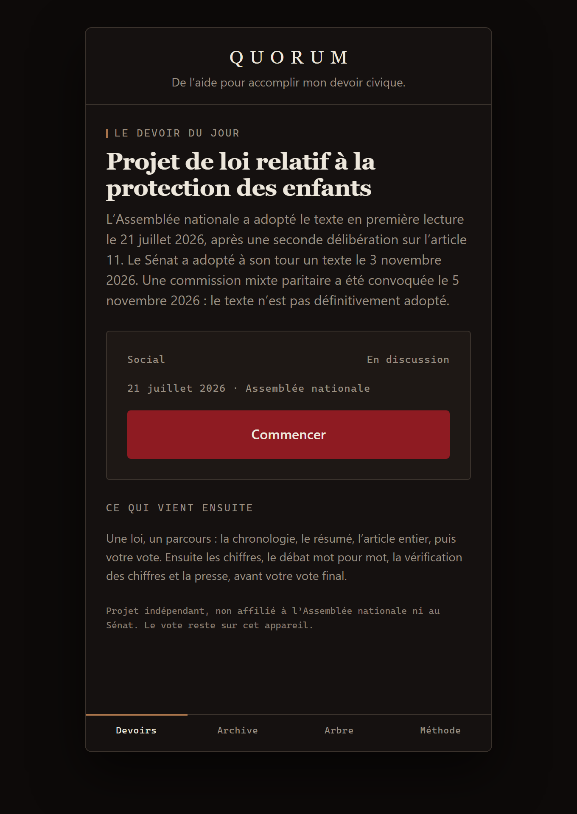
  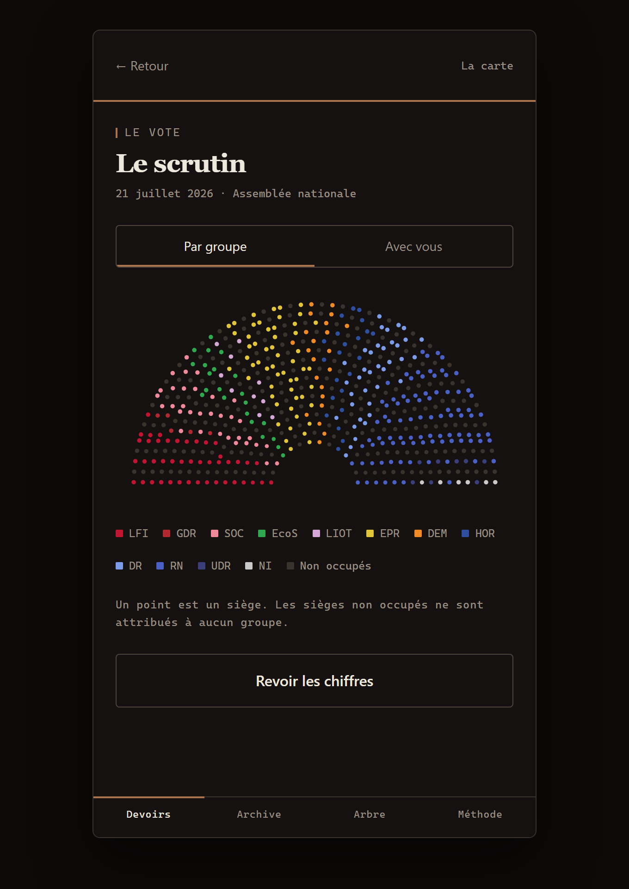
</p>

## Ce que vous obtenez

Un devoir se lit dans l'ordre où une loi se fait, pas dans l'ordre où un fil
d'actualité la raconte. Dix étapes, en trois temps.

**Avant votre vote**

1. **La chronologie** — du dépôt du texte au vote, chaque étape datée, avec sa source.
2. **Le résumé** — ce que change la loi, en quelques phrases sourcées.
3. **L'article entier** — le texte travaillé mot pour mot, alinéa par alinéa.

**Votre premier vote**

4. **Votre vote** — après avoir lu, pas avant.

**Après votre vote**

5. **Les chiffres** — pour, contre, abstentions, votants, exprimés, et la règle appliquée.
6. **Le débat, mot pour mot** — trois voix de chaque côté, recopiées des comptes rendus.
7. **Les chiffres vérifiés** — ce que les députés ont affirmé, confronté à une source,
   avec un verdict qui ne dit jamais si la loi est bonne.
8. **La presse** — les titres des journaux, tels quels, avec leur date et leur lien.
9. **Votre vote final** — le même vote ou un autre ; l'application ne commente ni l'un ni l'autre.
10. **La carte** — l'hémicycle, un point par siège, pour situer le scrutin et votre position.

## Pourquoi vous pouvez y faire confiance

Quorum ne vous persuade pas : il vous équipe. Cinq règles non négociables.

- **Source ou silence.** Chaque phrase publiée vient d'un fichier source : compte rendu,
  texte officiel, décompte de l'Assemblée, titre de presse. Sans source, l'écran écrit
  « non documenté ».
- **Les deux bords, à égalité de place.** Le débat cite des interventions des deux côtés,
  sans trancher. Vous voyez les arguments, pas leur emballage.
- **Les chiffres ont un verdict, pas une opinion.** « confirmé », « nuancé » ou
  « non documenté » disent ce que la source établit, jamais si le texte est bon.
- **Rien n'est relu à la main.** La publication dépend de contrôles automatiques
  bloquants : un fichier qui échoue n'est pas publié, et le passage refuse plus qu'il
  ne corrige.
- **Votre vote est privé.** Il n'est ni collecté, ni monétisable, ni visible par quiconque.
  L'arbre de progression récompense ce que vous avez lu, jamais ce que vous avez choisi.

## Ce que Quorum ne fait pas

- **Aucun avis sur la loi.** Pas de « pour / contre » déguisé, pas de score, pas de
  recommandation de vote. Les seules phrases qui qualifient sont des citations.
- **Aucun chatbot.** L'application ne génère pas de texte : elle affiche des fichiers
  préparés à l'avance. Aucun modèle, aucune clé, aucun appel réseau hors fichiers locaux.
- **Aucun compte.** Pas de profil, pas de commentaire, pas de classement public des opinions.
- **Aucun pistage.** Le vote reste dans le navigateur, sur l'appareil. Rien n'est transmis.

## Les évolutions possibles

Le socle est déjà celui d'un corpus : une génération hors ligne écrit des JSON, un
contrôle les accepte, l'application les sert sans backend. Ajouter une loi ne touche
pas au front.

| Évolution | Ce qu'elle change pour le lecteur | État |
|---|---|---|
| Archive de lois | toutes les lois, pas seulement celle du jour | 1 loi publiée |
| Recherche dans l'archive | retrouver un texte, un article, une citation | désactivée sous 10 lois |
| Recherche par le sens (RAG) | chercher une idée, pas un mot-clé | non implémenté |
| Séries thématiques | relier plusieurs lois d'un même thème | non implémenté |
| Sénat comme vote principal | suivre aussi la seconde chambre | bloqué : `data/ref/senat.json` absent |
| Backend de génération | produire les fiches en tâche de fond | non implémenté |
| Générateur versionné | rendre la collecte reproductible | absent : écriture manuelle |
| API du corpus | servir les mêmes données à des tiers | non implémenté |

Le détail technique de ces évolutions est dans `docs/roadmap.md` et
`docs/pipeline-freemium.md`.

## Le business model possible

> **Non implémenté.** Aucun compte, aucun paiement, aucun backend payant n'existe
> aujourd'hui. Tout ce qui est publié est gratuit et lisible hors ligne.

Le produit est un corpus généré une fois, servi à tous en fichiers statiques : le coût
de production est mesuré, le coût marginal d'un lecteur supplémentaire reste celui de
l'hébergement.

| Gratuit (état actuel) | Payant (envisageable, non implémenté) |
|---|---|
| la loi du jour, en entier | archive thématique au-delà de la loi du jour |
| la chronologie, le résumé, l'article entier | séries historiques (« les lois de… ») |
| le premier vote, les chiffres | recherche plein texte dans l'archive |
| le débat mot pour mot | export, dossiers de travail |
| les chiffres vérifiés, la presse | API ou licence B2B du même corpus |
| `#/methode`, `#/arbre` | — |

Trois axes de revenus possibles, sans prix fixé à ce jour : un abonnement grand public
pour l'archive, une licence du corpus pour les rédactions, ONG et collectivités, et une
API pour les développeurs. Aucun tarif n'est documenté ; la recharge Hémicycle commence
à 100 € HT.

Trois interdits structurent l'offre :

1. **On ne vend pas le résultat d'un vote.** Le vote n'est ni collecté ni monnayable ;
   les XP ne récompensent que le parcours.
2. **La chronologie ne dépend pas du paiement.** La chronologie, le vote et le débat de
   la loi du jour restent gratuits : payer ne change pas ce qui est vrai.
3. **On ne vend pas de données personnelles.** Il n'y en a pas aujourd'hui.

Le coût de production mesuré est de 0,08 à 0,15 € par loi (trajet minimal ou complet),
0,23 à 0,25 € avec les agrégats. À 1 000 lois, la collecte coûte 80 à 150 € ; le stockage,
l'hébergement et le paiement ne sont pas mesurés. Ce qui bloque une offre payante
aujourd'hui : la redistribution commerciale des données Hémicycle n'est pas documentée,
et la licence des données du Sénat n'est pas confirmée.

## Les écrans

Écrans réels, capturés par `node scripts/captures.mjs` (680 × 960, thème sombre).
Les maquettes, elles, sont dans `assets/mockups/`.

| **Le devoir du jour**<br>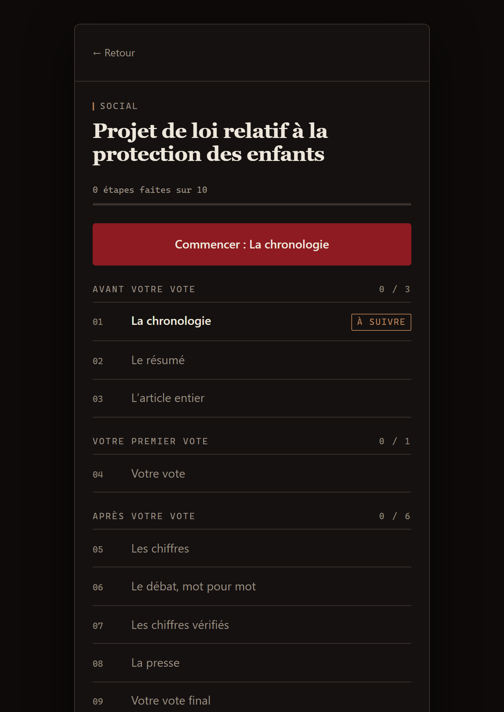 | **La chronologie**<br>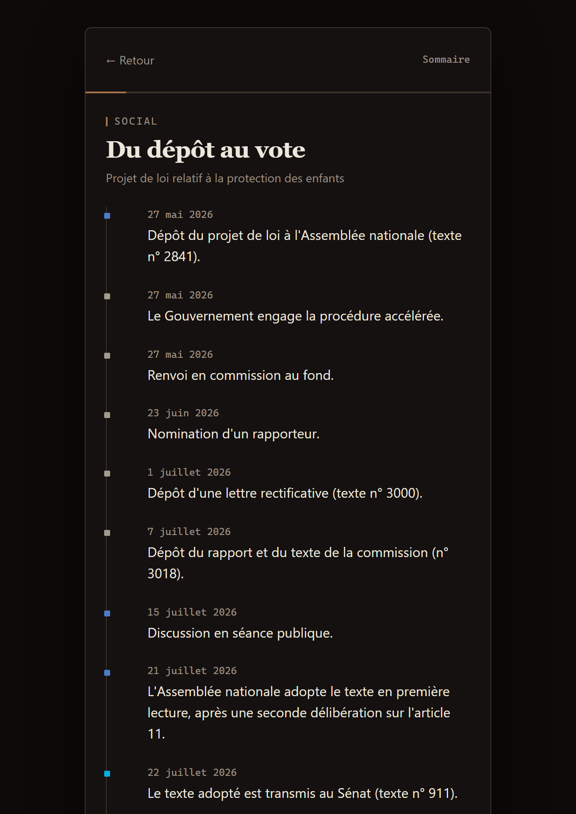 |
|---|---|
| **Le résumé**<br>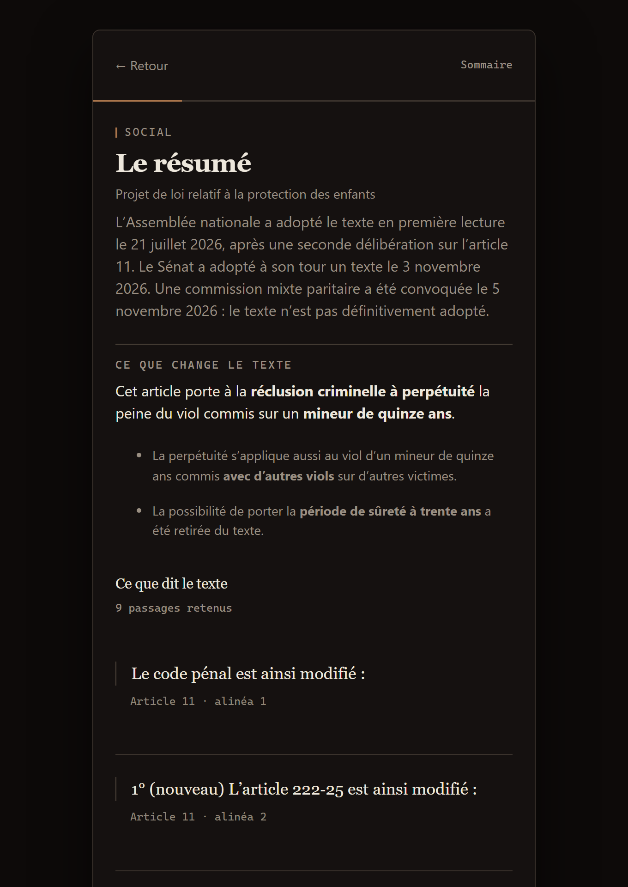 | **L'article entier**<br>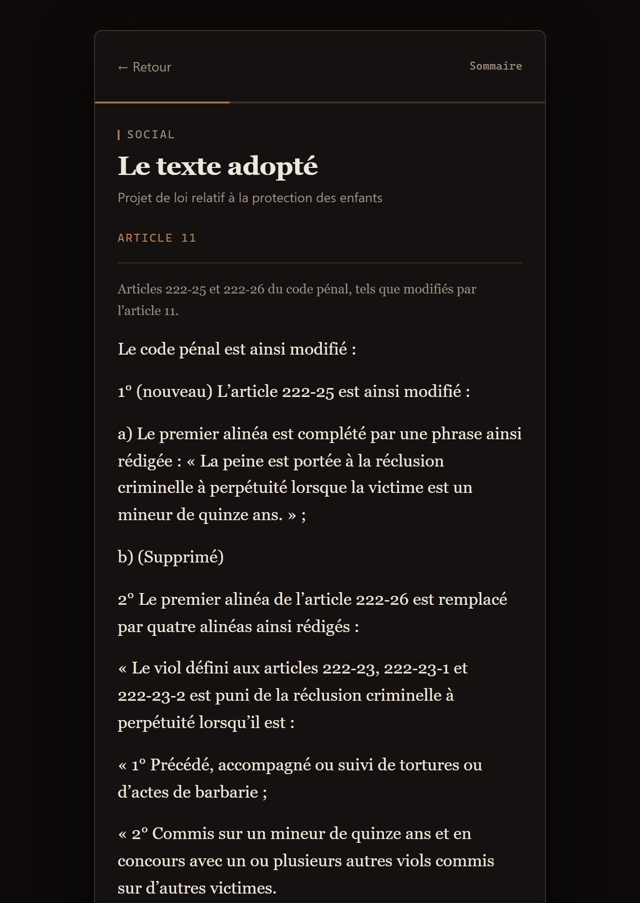 |
| **Votre vote**<br>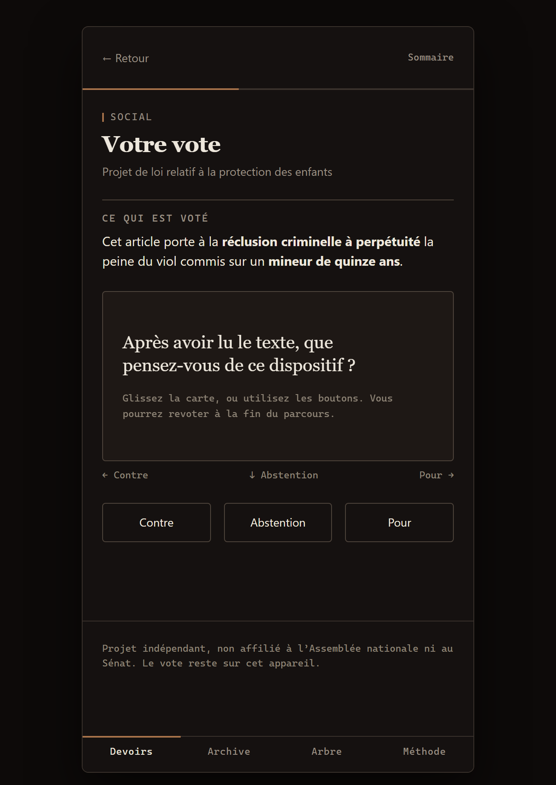 | **Les chiffres**<br>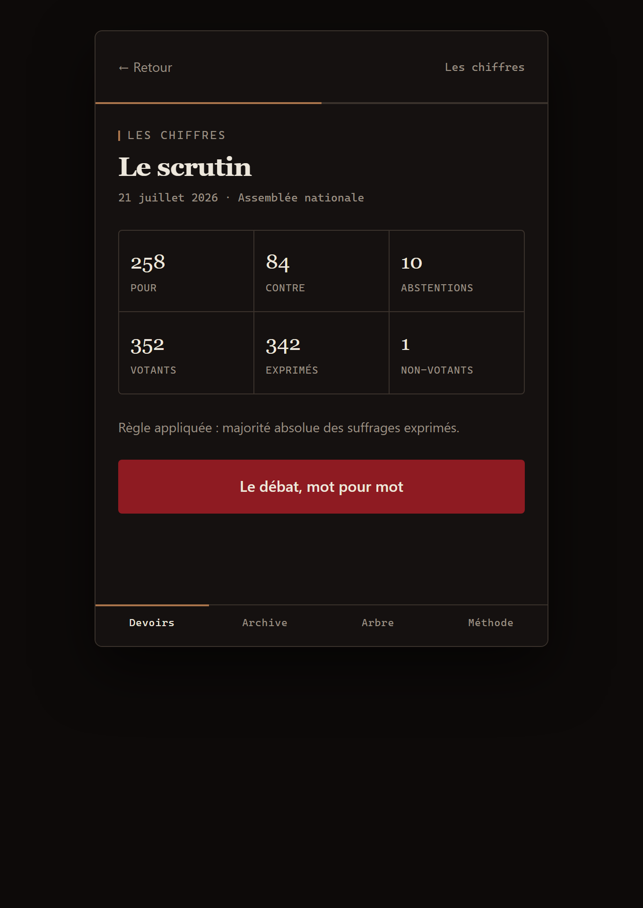 |
| **Le débat, mot pour mot**<br>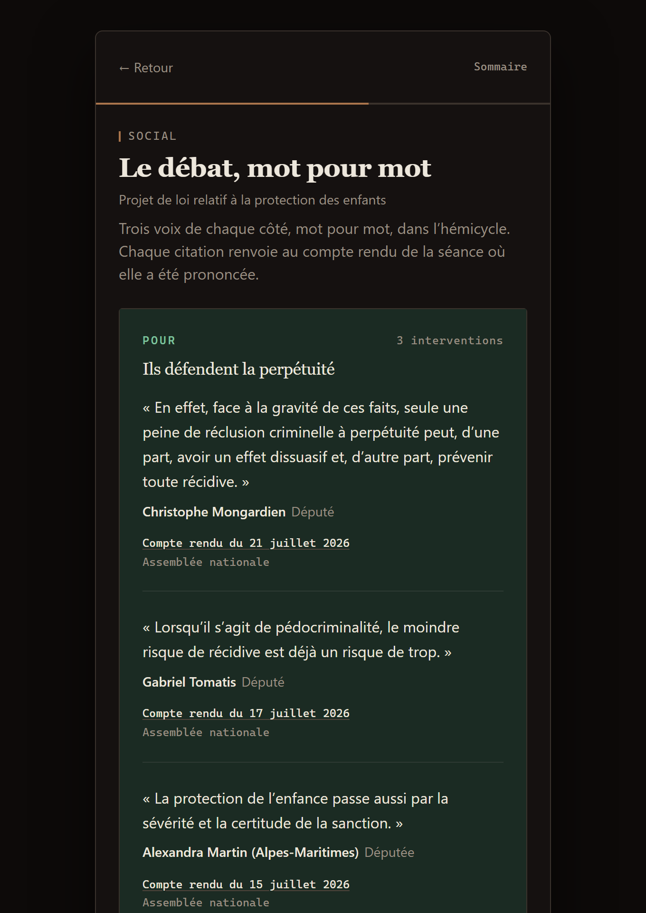 | **Les chiffres vérifiés**<br>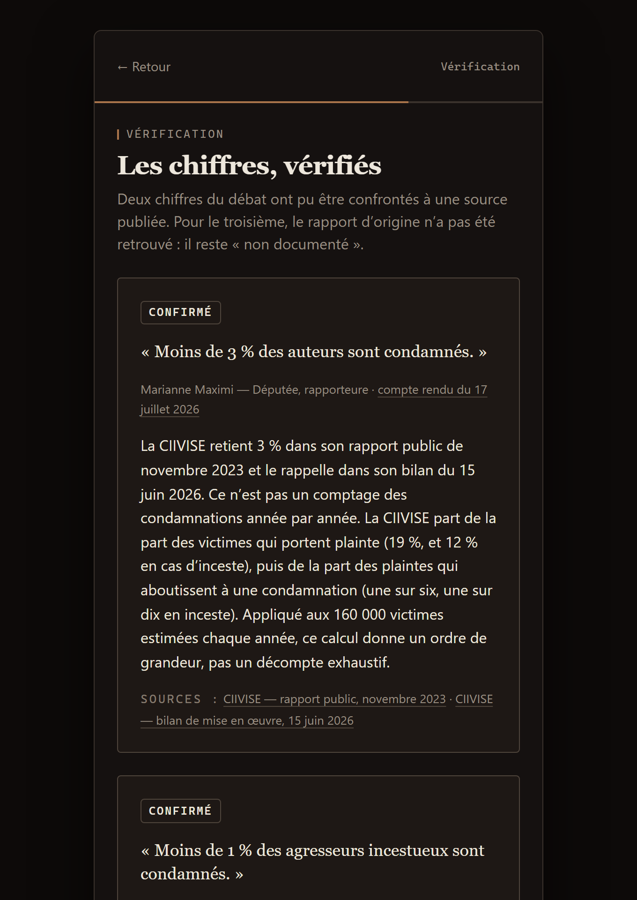 |
| **La presse**<br>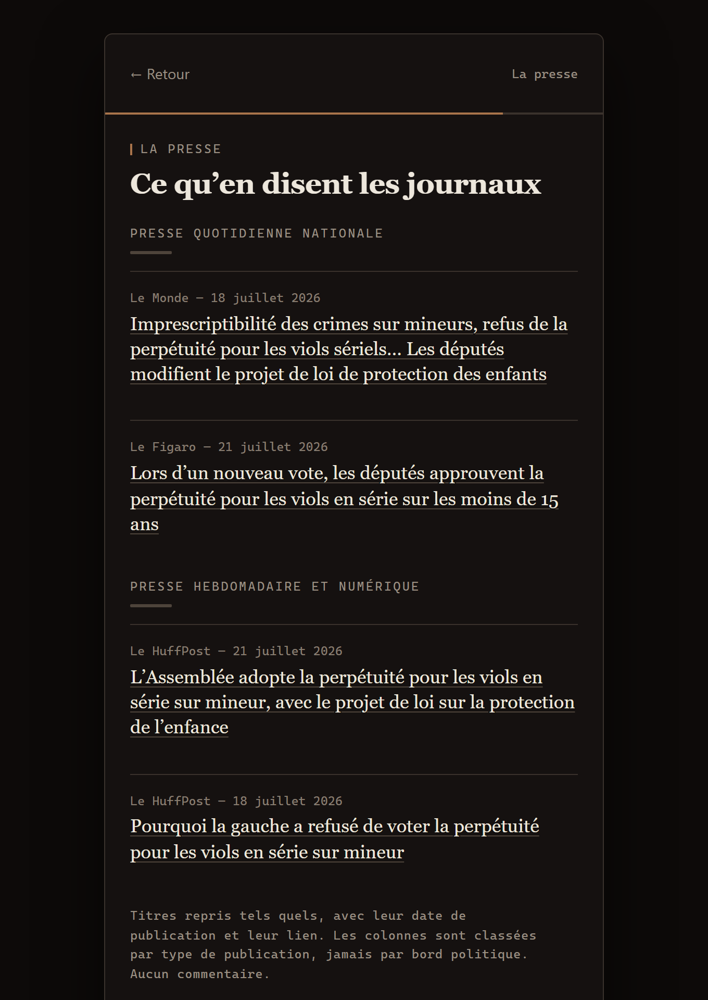 | **Votre vote final**<br>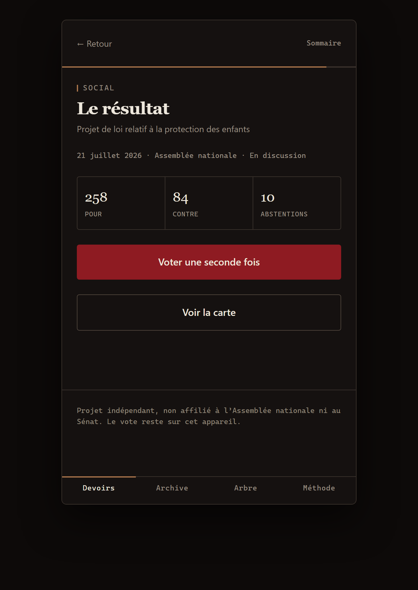 |
| **L'arbre de progression**<br>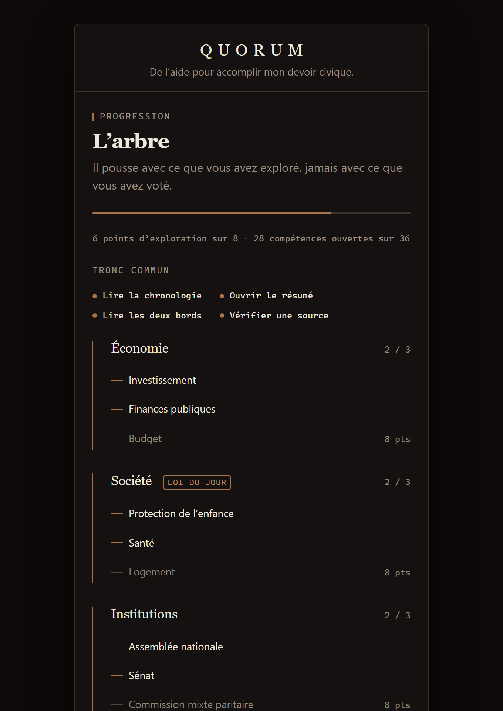 | **La méthode**<br>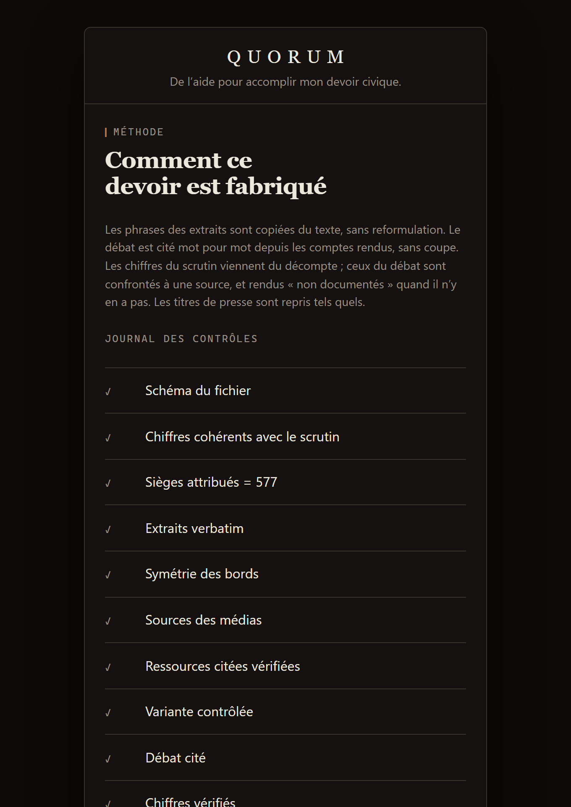 |

## Essayer

```
python -m http.server 8000
```

Ouvrir `http://127.0.0.1:8000/`. Aucune installation, aucun build, aucune dépendance.
Un serveur est nécessaire : `file://` ne charge ni les JSON ni le service worker.

La démo publique suit une seule loi, le projet de loi relatif à la protection des
enfants, scrutin n° 8429 du 21 juillet 2026.

Routes principales :

- `#/` accueil et loi du jour
- `#/devoir/protection-enfants` sommaire du devoir
- `#/devoir/protection-enfants/chronologie` ce qui s'est passé
- `#/devoir/protection-enfants/resume` résumé et extraits
- `#/devoir/protection-enfants/article` texte entier
- `#/devoir/protection-enfants/vote` premier vote
- `#/devoir/protection-enfants/chiffres` décompte
- `#/devoir/protection-enfants/debat` le débat mot pour mot
- `#/devoir/protection-enfants/verif` les chiffres vérifiés
- `#/devoir/protection-enfants/presse` titres de presse
- `#/devoir/protection-enfants/resultat` vote final
- `#/devoir/protection-enfants/vote-final` second vote
- `#/devoir/protection-enfants/carte` hémicycle
- `#/archive` archive des lois publiées
- `#/recherche` recherche (désactivée sous 10 lois)
- `#/arbre` progression
- `#/methode` journal des contrôles

## Sous le capot

Tout est statique : HTML, CSS et JavaScript natifs, une PWA qui fonctionne hors ligne.
L'application ne lit que des fichiers JSON publiés ; elle n'appelle ni Hémicycle, ni
service d'IA à l'exécution.

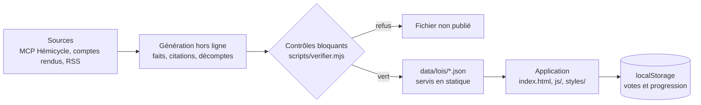

### Les données

Une seule loi est publiée. Ce qu'elle contient, tel que le contrôle l'a accepté :

| Élément | Valeur |
|---|---|
| dossier | `DLR5L17N54372` |
| scrutins | 2, le même jour (`VTANR5L17V8428`, `VTANR5L17V8429`) |
| chronologie | 13 étapes |
| article travaillé | article 11, 9 alinéas |
| citations au verbatim | 9, recopiées des comptes rendus |
| débat cité | 3 passages par bord |
| presse | 2 + 2 titres |
| chiffres vérifiés | 3 |
| groupes | 12, pour 577 sièges |

Le scrutin n° 8429 : 258 pour, 84 contre, 10 abstentions, 1 non-votant ; 352 votants,
342 exprimés.

### Les contrôles

Le passage s'appelle **gate 5** : `scripts/verifier.mjs` refuse un fichier dès qu'un
contrôle échoue. Neuf codes `WP1.1` à `WP1.9` vérifient le schéma, les dates, les
décomptes, le verbatim, la symétrie du débat et de la presse, les ressources citées,
la variante supprimée et les chiffres vérifiés. Un fichier marqué d'un nom en `_` est
un brouillon : il n'est jamais publié.

```
node scripts/verifier.mjs                    # tous les fichiers publiés
node scripts/verifier.mjs data/lois/x.json   # un seul
node scripts/verifier.mjs --reseau           # vérifie aussi que chaque URL répond
node scripts/preuve-gate.mjs                 # prouve que le passage accepte et refuse
```

`preuve-gate.mjs` fabrique un fichier complet, le fait accepter, puis introduit une
faute à la fois et exige le refus : 12 cas sur 12. Ce script ne prouve pas que la base
est vraie ; il prouve que la publication refuse ce qui n'est pas vérifiable.

### Les fichiers

- **Application** : `index.html`, `styles/`, `js/`, `service-worker.js`, `manifest.json`.
  Aucun CDN, aucune police distante.
- **Lois** : `data/lois/index.json` liste les lois ; `data/lois/<id>.json` porte le contenu.
- **Textes suivis** : `data/lois/suivis.json`, corpus distinct de textes suivis `v2` :
  actes datés sourcés, sans vote ; il n'entre ni dans `index.json` ni dans le gate des lois.
- **Référentiels fermés** : `data/ref/medias.json` (13 médias),
  `data/ref/experts.json` (14 fiches), `data/ref/verbatim.json` (4 séances, 9 passages).
  Une source absente de ces listes est refusée.
- **État local** : `localStorage`, clés `quorum.v1` (votes et progression) et
  `quorum.plan.v1`. Rien n'est transmis.
- **Documentation** : `docs/technique.md` (architecture, contrôles, limites détaillées),
  `docs/methode-donnees.md` (fabrication d'une fiche, pas à pas),
  `docs/pipeline-freemium.md` (chaîne complète, contrôles, coûts, freemium),
  `docs/roadmap.md` (RAG, montée en charge : non implémenté).

### Le dépôt

```
.
├── index.html              coquille de l'application
├── manifest.json           PWA
├── service-worker.js       hors ligne, réseau d'abord
├── styles/                 jetons, mise en page
├── js/                     hémicycle SVG, routage et écrans
├── data/lois/              fiches publiées, index, textes suivis, brouillons _
├── data/ref/               référentiels fermés et arbre
├── docs/                   méthode, pipeline, technique, roadmap, captures
├── assets/                 icônes et maquettes
└── scripts/                gate, preuve du gate, captures d'écran
```

## Limites

- Une seule loi est publiée ; `data/lois/index.json` a une entrée.
- La recherche est désactivée sous 10 lois, par choix explicite dans `js/app.js`.
- Le texte des discours n'est pas servi par le MCP Hémicycle : il vient des comptes
  rendus intégraux, recopiés et contrôlés un par un.
- Le Sénat n'est pas modélisé comme vote principal : `data/ref/senat.json` n'existe pas.
- Le classement d'un titre de presse dans sa colonne éditoriale n'est pas contrôlé par
  le gate ; la colonne n'est pas une donnée officielle.
- Le gate refuse l'invention, pas le mauvais choix de sélection.
- Le RAG, le backend et le freemium décrits plus haut ne sont pas implémentés ; le
  détail est dans `docs/roadmap.md`.

## Contribuer

Prérequis : Node.js pour les scripts, Python pour le serveur local. Aucun `npm install`,
aucun build.

```
node scripts/verifier.mjs
node scripts/verifier.mjs --reseau
node scripts/preuve-gate.mjs
node scripts/mobile.mjs         # captures 390 et 360 px, débordement
node scripts/captures.mjs       # captures du README, 680 px
```

- `verifier.mjs` doit rendre `Verdict : 1 fichier(s) conforme(s). Publication autorisée.`
  et un code de sortie 0. Un code 1 est un refus, pas un avertissement.
- `preuve-gate.mjs` doit rendre `Preuve tenue : 12 cas sur 12.`
- `mobile.mjs` et `captures.mjs` pilotent le Chrome installé via le protocole DevTools,
  sur un serveur déjà lancé à `http://127.0.0.1:8000`. Chrome absent : définir `CHROME_PATH`.
  `captures.mjs` part d'une mémoire locale vierge pour chaque écran : aucune capture ne
  montre un vote ni une progression héritée d'un autre écran.

Règles de contribution :

1. Le gate vert passe **avant** la mise à jour de `index.json`, jamais l'inverse.
2. Un fichier `_…` reste un brouillon : il ne s'indexe pas.
3. Un chiffre sans source s'écrit « non documenté » ; il ne s'invente pas.
4. Les JSON sont écrits en UTF-8 sans BOM.
5. Aucune dépendance, aucun framework JS, aucun CDN, aucune police distante.
6. Aucun secret dans un fichier versionné : les clés passent par l'environnement.
7. Toute nouvelle loi suit `docs/methode-donnees.md`.

## Licence et indépendance

Projet indépendant, non affilié à l'Assemblée nationale ni au Sénat. Les données
parlementaires sont reprises sous Licence Ouverte (Etalab) ; les titres de presse sont
cités avec leur date et leur lien.
