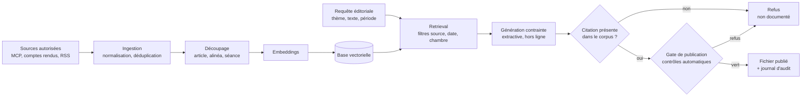

# Roadmap technique — RAG, montée en charge, freemium

Ce document rassemble ce qui est prévu au-delà de l'application statique actuelle :
RAG, montée en charge, freemium. Rien n'en est implémenté.

## Le RAG backend, plus tard

> **Statut : non implémenté.** Aucun embedding, aucune base vectorielle, aucun service de
> génération, aucun backend n'existe dans ce dépôt au 14 novembre 2026. Cette section décrit
> une architecture cible et des garde-fous, pas une fonctionnalité.

### Architecture cible

Les étapes, dans l'ordre :

1. **Ingestion** : MCP Hémicycle, comptes rendus intégraux, flux RSS autorisés. Normalisation
   des espaces, apostrophes et tirets, comme `normaliser()` dans le gate.
2. **Découpage** : unités citables (article, alinéa, prise de parole, titre de presse), avec
   identifiant de source, séance, date et URL.
3. **Embeddings** : vecteurs calculés une fois par lot, jamais dans le navigateur. Modèle,
   dimension et coût : **non documentés** à ce jour.
4. **Base vectorielle** : index lecture seule, avec métadonnées de source et version de corpus.
   Produit, hébergement et sauvegarde : **non documentés**.
5. **Retrieval** : sélection de passages par similarité et filtres durs (source autorisée,
   date, chambre, thème). Un score de similarité n'est pas une preuve.
6. **Génération contrainte** : le modèle ne rédige pas un texte libre. Il choisit et assemble
   des passages du corpus, avec leur identifiant et leur lien. Toute phrase sans citation est
   rejetée.
7. **Citations obligatoires** : chaque affirmation publiée porte sa source (URL, date,
   séance ou alinéa). Pas de citation, pas de publication.
8. **Gate de publication** : les contrôles automatiques existants restent l'ultime arbitre.
   Le RAG ajoute des contrôles de couverture et de citation, il n'en retire aucun.
9. **Journal d'audit** : corpus utilisé, identifiants des passages, scores de retrieval,
   modèle et version de prompt, version du gate, coût de l'appel. Aujourd'hui `meta` porte
   `genere_le`, `gate`, `modele` et `controles` ; `prompts_version` et `couts` sont décrits
   dans `PLAN.md` mais absents du fichier publié.

### Ce que le RAG apporterait

- **Recherche dans l'archive** : retrouver une loi, un article ou une citation par le sens,
  pas seulement par mot-clé. Aujourd'hui l'écran `#/recherche` est désactivé sous 10 lois, et
  l'archive n'en contient qu'une.
- **Séries thématiques** : relier plusieurs lois d'un même thème, avec les sources de chaque
  étape.
- **Assistant éditorial hors ligne** : aider à trouver les passages candidats, les séances et
  les titres de presse avant l'écriture manuelle. Il travaille dans le pipeline, pas dans
  l'application publiée.

### Ce qu'il ne doit jamais faire

- **Répondre à la place du citoyen** : pas de « votez pour », pas de recommandation, pas de
  personnalisation selon le vote enregistré.
- **Produire un verdict sur la loi** : le RAG peut dire ce que la source établit, jamais si
  le texte est bon ou mauvais.
- **Remplacer une source** : un passage généré sans citation officielle n'est pas publiable.
  Le corpus officiel reste la référence, pas l'index vectoriel.
- **Transformer une similarité en fait** : un passage proche n'est pas un passage qui répond.

### Les garde-fous

1. **Citation obligatoire** : identifiant de source, URL, date, séance ou alinéa.
2. **Refus si la source manque** : la sortie est « non documenté », jamais une phrase
   plausible sans appui.
3. **Séparation stricte** : la génération tourne hors ligne, en lot ; l'application publiée
   ne lit que des fichiers validés. Aucun modèle, aucune clé, aucune base vectorielle dans le
   navigateur.
4. **Pas de génération à la demande** : le RAG produit un corpus, le gate le publie. Une
   requête utilisateur ne déclenche pas un appel de modèle dans la version statique.
5. **Pas de données personnelles** : le vote reste dans `localStorage` et n'entre ni dans
   l'index, ni dans les prompts, ni dans les journaux.
6. **Traçabilité** : version du corpus, du prompt, du gate et coût de chaque lot.

Ce que le RAG ne règle pas : le biais de sélection reste celui du choix des passages ; un
embedding ne prouve pas qu'une phrase est vraie ; le gate ne juge toujours pas le sens. Le
RAG déplace le problème vers la qualité du corpus et des citations, il ne le supprime pas.

## Collecte à l'échelle (scrap)

Le dépôt ne contient pas de scraper. La collecte est un enchaînement d'appels MCP, de
téléchargements de comptes rendus et de lectures de flux RSS, avec une écriture manuelle du
JSON. La question « 100 ou 1 000 lois » est donc un exercice de dimensionnement, pas un
résultat mesuré.

### Ce qui est déjà fait, sur une loi

- Un dossier, deux scrutins, 13 étapes de chronologie, 9 alinéas, 9 extraits.
- 4 séances dépouillées, 9 citations au verbatim, 3 + 3 passages de débat.
- 2 + 2 titres de presse, 3 chiffres vérifiés, 12 groupes, 577 sièges.
- Un gate vert et 12 cas de refus prouvés.
- Un coût documenté de 8 crédits pour le trajet minimal, 13 à 15 pour le trajet complet,
  23 à 25 avec les agrégats. À `valeur_eur: 0.01` le crédit, cela fait 0,08 à 0,15 € par loi
  pour les deux premiers trajets, 0,23 à 0,25 € avec agrégats.

### Ce qu'il faudrait pour 100 ou 1 000 lois

| Sujet | Ce qui manque aujourd'hui |
|---|---|
| File d'attente | Un traitement par dossier ou scrutin, avec états, reprise et abandon. `PLAN.md` prévoit deux tentatives avec l'erreur en entrée, puis l'abandon : non implémenté. |
| Idempotence | Une clé stable (dossier, scrutin) et une empreinte de source. Aujourd'hui rien n'empêche de réécrire ou de dupliquer une entrée. |
| Versionnement | Le gate est versionné (`"5"`), le cache aussi (`quorum-v24`), mais il n'y a ni version de corpus ni `prompts_version` dans le fichier publié. |
| Coût | 100 lois à 8–15 crédits = 800–1 500 crédits, soit 8–15 € à la valeur mesurée ; 1 000 lois = 8 000–15 000 crédits, soit 80–150 €. Hors hébergement, stockage, modèles et paiement. La recharge commence à 100 € HT ; l'équivalent en crédits et un éventuel prix de volume sont **non documentés**. |
| Qualité | Le gate refuse l'invention, pas le mauvais choix. À 1 000 lois, le classement de presse, la sélection des citations et la rédaction du résumé restent les points faibles. |
| Déduplication | Un même texte peut produire plusieurs scrutins, une même citation plusieurs fiches, un même titre plusieurs colonnes. Aucun mécanisme de doublon n'est versionné. |
| Sénat | Le MCP sert des données sénatoriales, mais l'application n'a pas de `data/ref/senat.json` : le gate refuse `chambre: "Sénat"` comme vote principal. Une étape sénatoriale reste possible dans `chronologie`. |
| Presse | 13 médias en liste fermée, 2 titres par colonne. La profondeur d'archive des flux RSS sur 1 000 lois n'est pas mesurée. |
| Rattachement | Le jeu `scrutins` n'a pas de colonne de rattachement au dossier : recherche plein texte puis contrôle manuel de chaque `objet_libelle`. |
| Pagination | `interroger` rend 200 lignes au plus ; un texte de plus de 200 amendements exige plusieurs pages (`decalage`). |
| Limites de débit | **Non documentées** pour un usage soutenu. |
| Stockage | La taille d'un corpus de 1 000 fiches et le mode d'indexation ne sont pas mesurés. |

À 1 000 lois, le problème principal n'est plus la collecte mais la **vérification** : chaque
fiche doit rester une sous-chaîne exacte d'une source, et le gate doit pouvoir refuser sans
relecture humaine. Un corpus plus gros augmente le nombre de refus à traiter, pas la
confiance dans le contenu.

## Modèle freemium

> **Statut : non implémenté.** Il n'y a aujourd'hui ni compte, ni paiement, ni backend, ni
> archive payante. Tout ce qui est publié est gratuit et lisible hors ligne. Cette section
> décrit une piste, avec ses coûts et ses points juridiques à valider.

| Gratuit (état actuel) | Payant (envisageable, non implémenté) |
|---|---|
| la loi du jour, en entier | archive thématique au-delà de la loi du jour |
| la chronologie, le résumé, l'article entier | séries historiques (« les lois de… ») |
| le premier vote, les chiffres | recherche plein texte dans l'archive |
| le débat mot pour mot | export, dossiers de travail |
| les chiffres vérifiés, la presse | API ou licence B2B du même corpus |
| `#/methode`, `#/arbre` | — |

Trois interdits structurent l'offre :

1. **On ne vend pas le résultat d'un vote.** Le vote de l'utilisateur n'est ni collecté ni
   monnayable ; les XP ne récompensent que le parcours, jamais le contenu du vote.
2. **La chronologie ne dépend pas du paiement.** La chronologie, le vote et le débat de la loi du jour
   restent gratuits : payer ne change pas ce qui est vrai.
3. **On ne vend pas de données personnelles.** Il n'y en a pas aujourd'hui.

Garde-fous de neutralité, quel que soit le modèle : aucun ciblage publicitaire par opinion,
vote ou thème ; aucun sponsor dans le corps d'un devoir ; aucun paywall sur la chronologie,
les chiffres et le débat ; le vote reste privé.

### Ce qui reste à vérifier avant toute offre payante

- **Licence des données de l'Assemblée nationale** : `source.licence` vaut « Licence Ouverte
  (Etalab) ». L'attribution et les conditions de réutilisation sont à respecter.
- **Redistribution commerciale des données Hémicycle** : **non documentée à ce jour**.
  C'est bloquant pour vendre une archive construite sur ces données.
- **Licence des données Sénat** : conditions de réutilisation non confirmées dans
  `lister_jeux`. Le Sénat n'est de toute façon pas modélisé comme vote principal.
- **Presse** : seuls des titres, dates et liens sont repris. Le droit de citation et les
  conditions de chaque média restent à vérifier.
- **RGPD** : aujourd'hui aucun compte, aucun identifiant, aucune mesure d'audience. Un
  backend payant créerait des comptes et des paiements : base légale, durée de conservation,
  sous-traitants et hébergement seraient à définir.
- **Hébergement** : non choisi. Un service statique ne peut pas protéger une archive : un
  fichier servi est téléchargeable. Un accès payant exige un hébergeur qui authentifie avant
  de servir le fichier.
- **Coûts** : 0,08 à 0,15 € par loi pour la collecte, mesuré ; hébergement, stockage,
  paiement, support et modèles ne sont pas mesurés. Aucun revenu n'est promis.
