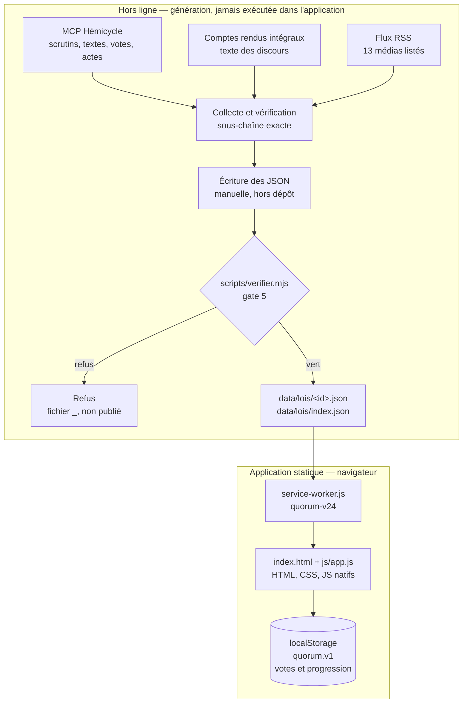

# Détail technique

Le détail de l'architecture, de la chaîne de données et des contrôles. Le README n'en
garde que l'essentiel ; ce document est la référence. Il décrit le dépôt au
14 novembre 2026.

## Ordre de lecture

L'ordre est linéaire : la chronologie, le résumé et l'article entier viennent **avant** le
premier vote. Le vote est demandé après avoir lu le texte, pas avant. Ensuite viennent les
chiffres, le débat, les chiffres vérifiés, la presse, le vote final et la carte.

Les anciennes adresses `/fait` et `/texte` renvoient vers `/chronologie` et `/resume`,
`/arguments` et `/experts` vers `/debat` et `/presse`.

## Plan du jour

`wp.html` lit `data/plan.json` (sept lots, leur fenêtre horaire, leurs tâches). Les cases
cochées restent dans le navigateur, sous la clé `quorum.plan.v1`. La page se met à jour à
l'horloge et signale le lot en cours et le lot en retard. Le contenu se modifie dans
`data/plan.json`, pas dans le HTML.

---

## Architecture actuelle



Trois couches, et une seule source de vérité à l'exécution :

1. **Fichiers statiques** : `index.html`, `styles/`, `js/`, `service-worker.js`, `manifest.json`.
   Aucun serveur applicatif, aucun CDN, aucune police distante.
2. **JSON publiés** : `data/lois/index.json` liste les lois ; `data/lois/<id>.json` porte le
   contenu ; `data/ref/` porte les référentiels (groupes, médias, experts, verbatim, arbre).
   L'application lit ces fichiers avec `cache: "no-store"`.
3. **État local** : `localStorage` sous la clé `quorum.v1` (votes et progression), et
   `quorum.plan.v1` pour les cases du plan. Rien n'est transmis.

Le pipeline de génération vit **hors ligne**. Il interroge le MCP Hémicycle, télécharge les
comptes rendus intégraux de l'Assemblée et lit les flux RSS des médias autorisés, puis écrit
les JSON. Le contrôle `scripts/verifier.mjs` décide de la publication. L'application ne
dépend ni de Hémicycle ni d'un service d'IA à l'exécution. Dans l'état actuel, ces appels et
l'écriture du JSON sont faits à la main : aucun générateur n'est versionné.

### Statut des briques

| Brique | État dans le dépôt |
|---|---|
| Application statique, PWA, hors ligne | existe |
| Une loi publiée, contrôles bloquants gate 5 | existe |
| Générateur versionné | absent : écriture manuelle du JSON |
| Backend de génération (v1 de `PLAN.md`) | non implémenté |
| RAG, embeddings, base vectorielle | non implémenté |
| Freemium, comptes, paiement | non implémenté |

`PLAN.md` décrit une v1 (backend, génération planifiée) et une v2 (freemium). Aucune des deux
n'est dans le dépôt aujourd'hui.

### Choix d'architecture

- **Pas de backend** : la sortie est un dossier de fichiers, hébergeable sur n'importe quel
  serveur de fichiers. Le service worker met la coquille et les données en cache.
- **Pas d'appel IA à l'exécution** : tout contenu affiché vient d'un JSON pré-généré. Une
  donnée absente donne « non documenté », jamais un texte inventé au chargement.
- **Vote privé** : le vote est écrit dans `localStorage`, jamais envoyé au générateur, au
  backend ou à un tiers. Aucun compte, aucune mesure d'audience, aucun identifiant.
- **XP de processus** : l'arbre compte huit actions (lire la chronologie, ouvrir le résumé,
  lire les deux bords, ouvrir la presse, lire les chiffres, voir l'hémicycle, premier vote,
  vote final). Un vote rapporte le même point quel que soit le choix ; changer d'avis n'en
  rapporte aucun. Aucun point ne vient du contenu du vote.
- **Pas de relecture humaine** : un contrôle automatique refuse, et un refus n'est pas
  rattrapé par un comité de lecture.

### Hors ligne

Le service worker met en cache la coquille et les données. En développement il sert le réseau
d'abord, pour que toute modification soit visible. Installer la PWA depuis Chrome, puis couper
le réseau : l'application doit continuer de fonctionner.

### Cache et versions

`index.html` charge les styles et les scripts avec `?v=24`, et `service-worker.js` déclare
`quorum-v24`. Les deux numéros avancent ensemble à chaque modification de code, sinon le
navigateur peut servir une ancienne version. Les JSON sont lus avec `cache: "no-store"` :
une donnée modifiée est visible au rechargement.

## La chaîne de données actuelle

Six temps. Le détail reproductible est dans `docs/methode-donnees.md` et
`docs/pipeline-freemium.md` ; cette section n'en donne que le contrat.

```
repérer → collecter → vérifier → générer → contrôler → publier
   ↑          ↑           ↑          ↑          ↑          ↑
  score     MCP + CR    sous-chaîne   JSON     gate 5    index.json
```

| Temps | Entrée | Sortie | Qui décide |
|---|---|---|---|
| Repérer | scrutins, actes, presse | liste classée de candidats | score objectivable + choix éditorial assumé |
| Collecter | MCP Hémicycle, comptes rendus, flux RSS | faits, décomptes, citations | la source, jamais le rédacteur |
| Vérifier | citations brutes | citations acceptées | comparaison de sous-chaîne |
| Générer | faits vérifiés | `data/lois/<id>.json` | rédaction dans un schéma fermé |
| Contrôler | le fichier | code 0 ou 1 | `scripts/verifier.mjs` |
| Publier | fichier accepté | entrée dans `data/lois/index.json` | le gate, pas l'auteur |

Trois entrées seulement : le MCP Hémicycle (données parlementaires), les comptes rendus
intégraux de l'Assemblée (texte des discours), et les flux RSS de `data/ref/medias.json`
(titres de presse). Toute autre source citée doit appartenir à la liste `DOMAINES` de
`scripts/verifier.mjs`.

### Ce que la chaîne a produit sur la seule loi publiée

| Élément | Valeur constatée |
|---|---|
| lois dans `index.json` | 1 |
| dossier | `DLR5L17N54372` |
| scrutins | 2 (`VTANR5L17V8428`, `VTANR5L17V8429`), le même jour |
| chronologie | 13 étapes |
| texte adopté / texte de commission | n° 338 / n° 3018 |
| article travaillé | article 11, 9 alinéas |
| extraits | 9, dont 1 étiqueté `supprime` |
| phrases calculées (`nb_phrases`) | 3 |
| séances dépouillées | 4 comptes rendus |
| citations au verbatim | 9 |
| débat cité | 3 passages par bord |
| presse | 2 + 2 titres |
| chiffres vérifiés | 3 |
| groupes | 12, pour 577 sièges |
| sièges présents / vides | 353 / 224 |

Le scrutin n° 8429 : 258 pour, 84 contre, 10 abstentions, 1 non-votant ; 352 votants,
342 exprimés. Le scrutin n° 8428 cité dans `variante` : 178 pour, 163 contre, 5 abstentions ;
346 votants, 341 exprimés.

### Les scripts et le gate

```
node scripts/verifier.mjs                    # tous les fichiers de data/lois
node scripts/verifier.mjs data/lois/x.json   # un seul
node scripts/verifier.mjs --reseau           # vérifie aussi que chaque URL répond
node scripts/preuve-gate.mjs                 # prouve que le passage accepte et refuse
```

`verifier.mjs` refuse, il ne corrige pas. Code de sortie 1 dès qu'un fichier est refusé.
Il vérifie le schéma, les dates, les décomptes, le verbatim, la symétrie de la presse et du
débat, les ressources citées, les chiffres vérifiés, les sources et l'absence de contenu de
démonstration. Un fichier dont le nom commence par `_` est ignoré : c'est un jeu de travail,
pas une publication.

Le passage est le **gate 5** : `meta.gate` doit valoir `"5"`. Neuf codes `WP1.1` à `WP1.9`
produisent dix lignes de journal, `WP1.2` couvrant à la fois les chiffres et les sièges.
Un fichier produit par une règle plus ancienne est refusé.

`preuve-gate.mjs` fabrique un fichier complet dans le dossier temporaire, le fait accepter,
puis introduit une faute à la fois et exige le refus : un siège de trop, un siège vide non
déclaré, un siège de groupe inventé, un média hors liste, une variante absente de sa source,
une variante encore dans le texte adopté, une étiquette `supprime` sur un passage ordinaire,
une citation retouchée, un `confirmé` sans source, un `non documenté` avec source, une
affirmation retouchée. Résultat attendu : **12 cas sur 12**.

Ce script ne prouve pas que la base est vraie ; il prouve que le passage **refuse**. C'est la
seule preuve que le projet s'autorise.

### Les listes fermées

Trois listes ferment la publication : `data/ref/medias.json` (13 médias), `data/ref/experts.json`
(14 fiches) et `data/ref/verbatim.json` (4 séances, 9 passages) doivent contenir le média, la
personne ou l'organisation citée, avec son domaine, son affiliation, son rôle ou son passage.
Une entrée absente est refusée, avec ou sans drapeau. Les domaines autorisés en dur sont
`assemblee-nationale.fr`, `senat.fr`, `legifrance.gouv.fr`, `vie-publique.fr`, `data.gouv.fr`,
`hemicycle.ai`, `ciivise.fr`, `justice.gouv.fr`, plus les domaines de `medias.json`.

`source.texte_url` est obligatoire : c'est le lien vers le texte officiel, affiché en bas de
l'écran « article entier » pour un fichier publié.

### Les sièges

Les sièges non occupés ne sont attribués à aucun groupe. Chaque ligne `votes_par_groupe` porte
son nombre de `sieges` présents (pour + contre + abstention + non-votants volontaires), et le
fichier déclare à part `sieges_vides`. Le contrôle exige
`somme(sieges) + sieges_vides = 577` : les absents restent des absents. Ils sont répartis sur
l'arc et peints d'une teinte neutre, jamais empilés d'un côté.

### Le bloc facultatif `variante`

Quand un vote adopté a supprimé une phrase du texte, le fichier peut porter un bloc
`variante` : la citation exacte (`avant`), le texte d'où elle vient (`texte_source`), et le
scrutin qui l'a retirée (`supprimee_par`). Le contrôle `WP1.7` exige que la phrase soit
**mot pour mot** dans `texte_source` et **absente** du texte adopté : si elle y est encore,
le fichier est refusé. Le même décompte est vérifié (`votants = pour + contre + abstentions`,
`exprimés = pour + contre`) et doit venir d'un autre scrutin que celui de la loi. Le bloc
n'apparaît dans l'écran « article entier » que s'il est présent et validé.

### Le débat cité (`WP1.8`)

Le bloc `debat` ne contient pas de reformulation : chaque entrée est une citation recopiée
d'un compte rendu. Le contrôle exige que la citation soit **mot pour mot** dans
`data/ref/verbatim.json`, avec la **même séance** et le **même auteur**, que la date et l'URL
correspondent à celles de la séance, et que le nom figure dans `data/ref/experts.json`. Une
citation retouchée d'un seul mot est refusée.

La symétrie se juge sur le **total de caractères par bord** (rapport maximal 2,5), pas sur
chaque extrait : des citations authentiques n'ont pas la même longueur, et tronquer la plus
longue pour équilibrer reviendrait à falsifier.

### Les chiffres vérifiés (`WP1.9`)

Le bloc `verifications` ne retient que des chiffres **prononcés dans l'hémicycle**. Chaque
entrée porte sa citation (contrôlée comme ci-dessus), un verdict parmi `confirmé`, `nuancé`,
`non documenté`, une explication d'au moins 80 caractères, et ses sources. Le chiffre doit
apparaître littéralement dans la citation qu'il commente.

L'affirmation, affichée entre guillemets au-dessus du chiffre, est contrôlée elle aussi :
après normalisation, en minuscules et sans le point final, elle doit être un **fragment
exact** de la citation. Une retouche, même d'un mot, est refusée.

Un verdict `confirmé` ou `nuancé` sans source est refusé ; un verdict `non documenté` **avec**
une source est refusé aussi, puisque c'est une contradiction : « non documenté » veut dire
qu'aucune source n'a été trouvée. Le verdict ne dit jamais si la loi est bonne : il dit
seulement ce que la source établit. Il est rendu en typographie, jamais en vert ni en rouge,
pour que « vrai » ne puisse pas se lire comme « pour ».

### Ce que le gate ne vérifie pas

- Le classement éditorial d'un titre de presse dans sa colonne : le gate contrôle le média,
  le domaine et le nombre, pas le choix de la colonne.
- Le sens d'une reformulation : `resume` et `ce_qui_est_vote` sont relus par le gate pour
  leur forme et leurs sources, pas pour leur neutralité.
- La qualité de la sélection : les contrôles prouvent que rien n'est inventé et que la
  sélection est visible, pas qu'elle est représentative.

Aucun script de génération n'est versionné. La collecte se fait par appels MCP dans une
session d'assistant ; l'écriture du JSON est manuelle, ou faite par un script jetable hors du
dépôt. Ce choix est volontaire : un générateur automatique produirait des fichiers que
personne n'a lus, et le gate ne juge pas le sens.

---

## Limites et ce qui reste non documenté

| Sujet | État |
|---|---|
| Archive | une seule loi publiée ; `index.json` a une entrée |
| Recherche | désactivée sous 10 lois, par choix explicite dans `js/app.js` |
| Rapport IGJ (inter-inspections) de juillet 2022, chiffre des 70 % | introuvable sur un site officiel : **non documenté**, donc non repris comme un fait |
| Vote du Sénat comme vote principal | impossible : `data/ref/senat.json` absent, le gate refuse `chambre: "Sénat"` |
| Texte des discours dans le MCP | **non servi** ; seule voie : les comptes rendus intégraux |
| Presse | titres seuls ; le bord est une classification Wikipédia contestée, affichée comme telle ; la colonne n'est pas contrôlée par le gate |
| Relecture humaine | aucune, pas même par échantillonnage ; le gate ne juge pas le sens |
| Générateur | aucun script versionné ; écriture manuelle du JSON |
| Champ `affirmation` | contrôlé : fragment exact de la citation (WP1.9) ; point final et majuscule initiale viennent de l'affichage |
| Prix d'un crédit à la recharge | **non documenté** ; seul `valeur_eur: 0.01` du solde est mesuré |
| Redistribution commerciale Hémicycle | **non documentée** |
| Licence des jeux Sénat | non confirmée |
| Limites de débit Hémicycle | **non documentées** |
| Hébergement cible | **non documenté** |
| RAG, backend, freemium | non implémentés |
| Maquettes | `assets/mockups/` sont des rendus, pas des preuves |

### Ce qui est vrai, ce qui ne l'est pas

- **Vrai** : la composition de l'Assemblée dans `data/ref/groupes.json`, avec sa source et sa
  date ; le scrutin n° 8429, le scrutin n° 8428 cité dans `variante`, la chronologie et les
  passages reproduits de `data/lois/protection-enfants.json`, tirés du MCP Hémicycle ; les
  titres de presse et les citations, avec leur lien.
- **Reformulé, source à l'appui** : les rares textes de synthèse (résumé, chronologie, points
  de l'article). Les prises de position ne sont plus reformulées : l'écran « Le débat, mot
  pour mot » donne les phrases des députés telles quelles, recopiées des comptes rendus et
  contrôlées une à une. Aucune position n'est qualifiée de meilleure.
- **Vérifié, avec sa limite** : les trois chiffres de l'écran « Les chiffres, vérifiés ». Le
  3 % et le 1 % sont confirmés par la CIIVISE (rapport public de novembre 2023, bilan du
  15 juin 2026) : ce sont des ordres de grandeur calculés à partir des plaintes, pas des
  comptages exhaustifs. Le 70 % reste « non documenté » : le rapport inter-inspections de
  juillet 2022 qui le porte n'a pas été retrouvé sur un site officiel, donc il n'est pas
  repris comme un fait.
- **Faux, assumé** : le contenu de `data/lois/_demo.json`. Il n'est pas publié ; l'index ne
  le cite pas. `data/lois/_archive-protection-souverainete-agricoles.json` est une loi
  retirée, gardée pour mémoire.
- **Maquette, assumé** : l'arbre de `data/ref/arbre.json`. Les 4 jalons, 8 thèmes et
  24 branches sont une nomenclature de démonstration ; seuls les points gagnés sont réels,
  ils ne comptent que des actions du parcours, jamais le contenu d'un vote.
- **Règle** : aucun contenu de démonstration ne doit être présenté comme vérifié dans une
  slide. Les images de `assets/mockups/` sont des maquettes.

---

## Contraintes tenues

- Aucune dépendance, aucun build, aucun CDN, aucune police distante.
- Aucun appel à un service d'IA à l'exécution.
- Le vote n'est jamais transmis.
- Chaque écran sans donnée affiche un état vide explicite, jamais un faux contenu.
- Aucune relecture humaine : la publication dépend de contrôles automatiques bloquants.
- Source ou silence : sans source, « non documenté ».
- Aucun jugement sur une loi : les seules phrases qui qualifient sont des citations.
